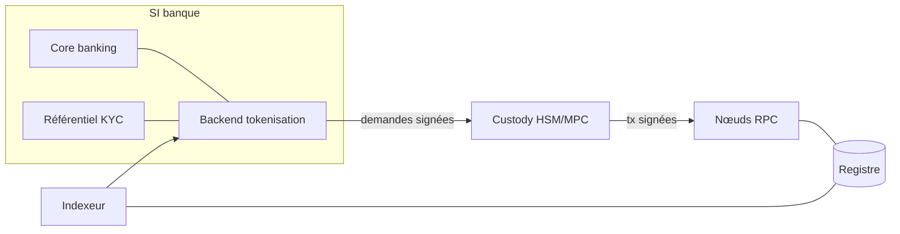
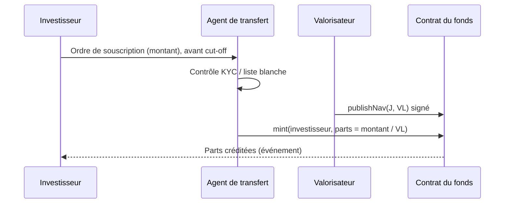

# ADR, risk register and views

## ADR template (French)

```markdown
# ADR-NNN — <Titre de la décision>

**Statut** : Proposé | À confirmer | Accepté | Remplacé par ADR-MMM
**Date** : AAAA-MM-JJ | **Décideurs** : <rôles> | **Exigences liées** : FR-xxx, NFR-xxx

## Contexte
<Le problème, les contraintes, ce qui rend la décision nécessaire maintenant. Sources citées.>

## Options étudiées
| Option | Avantages | Inconvénients | Réversibilité |
|---|---|---|---|
| A | | | |
| B | | | |

## Décision
<L'option retenue, en une phrase, puis la justification.>

## Conséquences
- Ce qui devient plus simple :
- Ce qui devient plus difficile :
- Ce qu'on abandonne :

## À confirmer
- [ ] <hypothèse ou contrainte externe à vérifier, avec son propriétaire>

<Si la décision est réversible, décrire le coût du retour arrière.>
```

Keep an ADR short. The value is in recording that a decision was made, why, and what was given up.

## Risk register format

```markdown
| ID | Risque | Gravité | Origine | Traitement retenu |
|----|--------|---------|---------|-------------------|
| RISK-001 | **<Énoncé factuel du risque>** <conséquence> | Élevée / Moyenne / Faible | <research.md R-xxx, ADR-xxx, constat> | <mesure, propriétaire, échéance> |
```

Always register: pre-1.0 dependencies, community-maintained plugins on the critical path, irreversible choices, single points of failure, single-vendor or single-region concentration, untested recovery procedures, open regulatory questions.

## View checklist

- [ ] Context: every external system and actor, with the nature of each exchange.
- [ ] Containers: every runtime component, its owner and its trust level.
- [ ] On-chain: every contract, standard, upgrade pattern and role holder.
- [ ] Flows: issuance, transfer with compliance check, redemption, key rotation, contract upgrade, incident (pause).
- [ ] Deployment: validator distribution, survivability of a zone or site loss, HSM placement, network boundaries.
- [ ] Each diagram has a title, a legend when colours or line styles carry meaning, and fits on one slide.

## Mermaid starters




